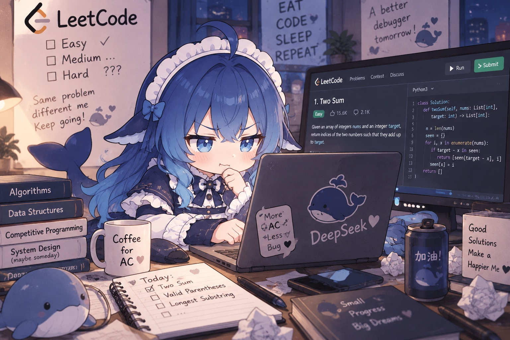
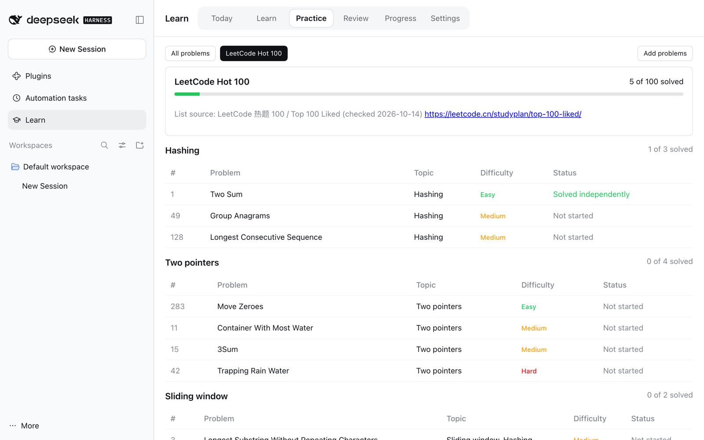
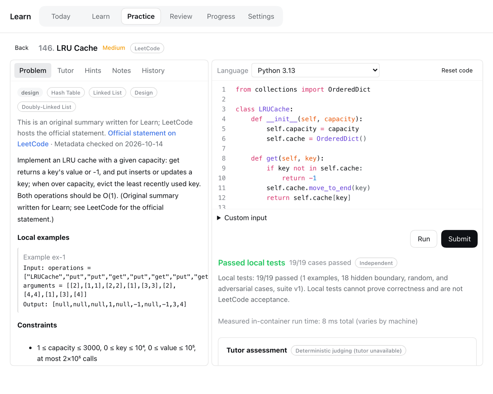
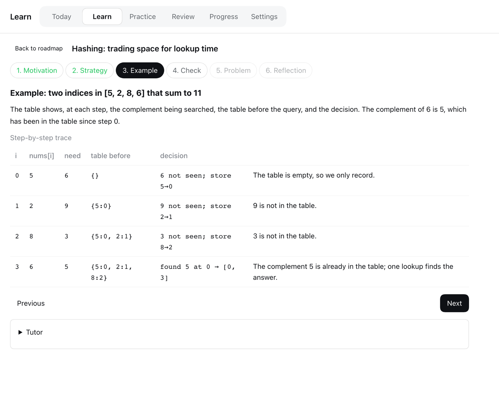
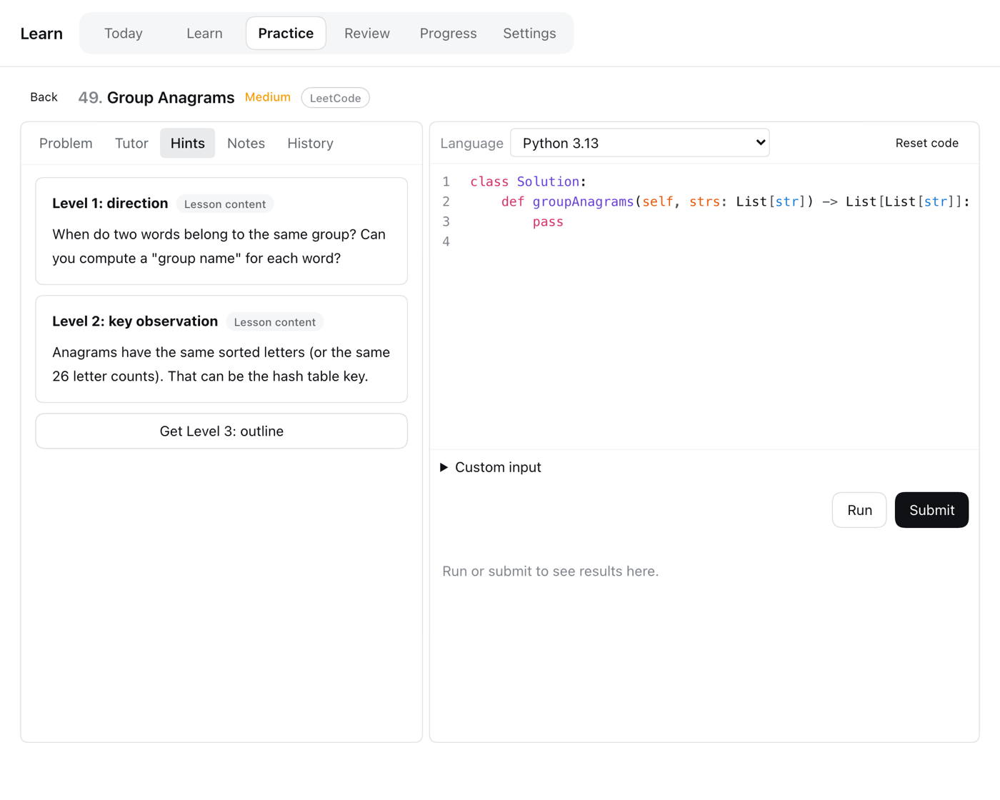
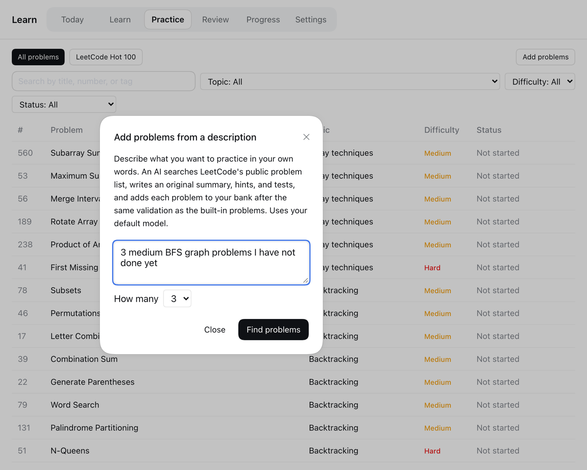

<div align="center">



# DeepSeek Harness LeetCode

**Learn algorithms inside [DeepSeek Harness](https://github.com/deepseek-ai/deepseek-harness): lessons, all of LeetCode Hot 100, a sandboxed judge, and an AI tutor.**

English | [中文](README.zh.md)


</div>

## Why

- **All of LeetCode Hot 100**, plus 8 more classics — each with an original summary, three progressive hints, and an explained solution. Statements stay on LeetCode; every problem links to the official page.
- **A real judge on your machine.** Code runs in Docker with no network. Hidden boundary, random, and large cases catch wrong and slow solutions — including design classes, in-place edits, and linked-list/tree node problems.
- **Lessons before problems.** 16 topics, from hashing to dynamic programming, each with a worked example you can trace step by step. Then the tutor writes a short check about the lesson, reviews your answers, and decides when you're ready for the practice problem.
- **Add problems by just describing them.** "3 medium BFS problems I haven't done" — an AI agent finds them on LeetCode, writes the tests, and adds them only if they pass validation.

## A closer look

<p align="center"><br><b>Hot 100</b> — LeetCode's own grouping, with your progress per group</p>

<table>
  <tr>
    <td width="50%"></td>
    <td width="50%"></td>
  </tr>
  <tr>
    <td align="center"><b>Solve</b> — editor, Run and Submit, hidden tests</td>
    <td align="center"><b>Learn</b> — worked examples you can trace</td>
  </tr>
  <tr>
    <td width="50%"></td>
    <td width="50%"></td>
  </tr>
  <tr>
    <td align="center"><b>Hints</b> — direction, key idea, outline, solution</td>
    <td align="center"><b>Add problems</b> — describe it, the agent does the rest</td>
  </tr>
</table>

Also included: an AI tutor chat, spaced-repetition reviews with fresh validated variants, progress by concept, and optional daily reminder email.

## Quick start

1. **Install Docker Desktop.** Learn then guides the rest: it can start Docker and download the runner images with one click, or run `docker pull python:3.13-alpine node:24-alpine` yourself.

2. **Install the plugin** from `github:kapelame/deepseek-harness-leetcode`:
   - **Desktop:** Plugins → install from GitHub.
   - **Web:**

     ```sh
     dsh plugin --profile web add github:kapelame/deepseek-harness-leetcode
     dsh web
     ```

3. **Open Learn** in the sidebar. Explanations default to Chinese; switch to English in Learn → Settings.

Needs DSH 0.2.0-rc.2 or newer, below 0.3 (tested on 0.2.0-rc.2 and 0.2.1-alpha.3). A default model (for example, signed in to DeepSeek) is optional: it powers the tutor, tutor-written lesson checks, AI feedback, and Add problems. Running, judging, written hints, and the lessons' built-in check questions work without one.

<details>
<summary><b>Install from the command line on Desktop</b></summary>

Quit Desktop completely, then run its bundled CLI and reopen Desktop:

```sh
"/Applications/DeepSeek Harness.app/Contents/Resources/runtime/cli/bin/dsh" plugin --profile desktop add github:kapelame/deepseek-harness-leetcode
```

The repository ships prebuilt files in `lib/`, so installing runs no build script. Pin a commit for reproducible installs: `github:kapelame/deepseek-harness-leetcode#<commit>`.

</details>

## How judging works

Every verdict comes from test execution only. Your code runs in a Docker container with no network, a read-only filesystem, and memory, CPU, and process limits; expected answers never enter the container. Each suite combines official example inputs with hidden boundary, random, and large cases, built from a reference solution and checked against an independent brute-force solution. A pass means **"passed local tests"**, not LeetCode acceptance. The optional AI judge adds feedback but can never change the verdict.

## Add problems

Practice → **Add problems**. Describe what you want and pick how many (1–5). Progress streams live, and you can stop at any time; problems already added stay.

- The agent follows the bundled skill [`skills/learn-problem-author/SKILL.md`](skills/learn-problem-author/SKILL.md), which is visible only to the finder agent, never in your normal Sessions.
- Number, title, difficulty, tags, signature, and examples always come from LeetCode's metadata, never from the model. Paid-only problems and problems that need a judge Learn does not provide are skipped.
- Each problem must pass the same validation as the built-in ones before it is added.

## Privacy

- Your code runs only inside offline Docker containers.
- With a default model, Submit (unless `agents.judge: false`), hints, tutor chat, reflections, and variant generation send the problem summary and your code to that model through DSH. Lesson checks send the lesson and your answers. Add problems sends your description and LeetCode metadata, never your code. Each run appears in your Session history.
- Add problems queries LeetCode's public GraphQL API for problem metadata only: no login, no statements, paced requests with a per-run budget.
- Nothing else leaves your machine, except reminder email if you configure SMTP.

<details>
<summary><b>Configuration</b></summary>

The plugin adds two rows to your profile: `learn` (the service) and `learn-ui` (the Remote API and UI). Override settings in the profile's `cordis.patch.yml`. A patch replaces the row's whole `config`, so keep `dataRoot`:

```yaml
- id: learn
  config:
    dataRoot: !!js dshHomePath('learn')
    defaultLocale: en
    reviewDailyLimit: 3
    agents:
      judge: false              # deterministic judging only, no AI feedback
      variantGeneration: true
    finder:
      enabled: true
      maxProblems: 5            # problems per Add problems run
      maxSubmissionsPerProblem: 3
      maxLeetcodeRequests: 40   # LeetCode requests per run
      requestIntervalMs: 1000
    email:
      transport: capture        # 'smtp' sends only with liveSendingAuthorized: true
```

Data lives in `learn/` under your DSH home (`~/.dsh` by default); Settings can export it as JSON or reset it.

Real email needs `email.transport: smtp`, `email.liveSendingAuthorized: true`, `email.smtp.host`/`port`/`user`, and the SMTP password stored as the DSH credential named by `email.smtp.passwordRef` (default `DSH_LEARN_SMTP_PASSWORD`). Without implicit TLS, STARTTLS is required.

</details>

<details>
<summary><b>Limitations</b></summary>

- Docker is required for running code. DSH's own process sandbox only restricts file writes (it allows network access and reading your files), so Learn does not use it as a substitute.
- Reminders are sent only while DSH is running with the plugin enabled; a missed daily digest is sent later the same day, never on a later day.
- TypeScript submissions have their types removed but are not type-checked.
- The tutor sees only the last ten messages of a conversation.
- While an AI run is active, its Session briefly appears in the sidebar.
- On Desktop, links in reminder emails point to a local port that changes on each launch; use the verification code in the email or set `email.publicBaseUrl`.

</details>

<details>
<summary><b>Build from source</b></summary>

`source/` holds three DSH workspace packages built with the DSH toolchain:

```sh
git clone https://github.com/deepseek-ai/deepseek-harness.git dsh
git -C dsh checkout dsh-v0.2.0-rc.2
node scripts/build.mjs ./dsh    # copy sources in, install, build, assemble lib/
```

Use `--skip-install` to rebuild an installed checkout. Run tests inside the checkout with `npx vitest run packages/experimental/learn/tests` (needs Docker).

Content lives in `content/` (`content/collections/hot-100.yaml` lists the Hot 100 groups). Each problem has YAML metadata with input domains, a reference solution, an independent brute-force oracle, optional hooks, and a frozen, validated test suite. `authoring/` holds the scripts that generate the Hot 100 content and freeze its suites.

</details>

## License

MIT
