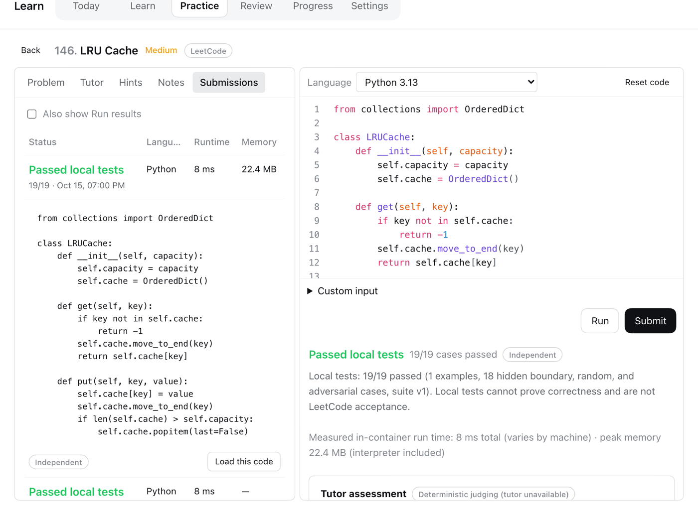
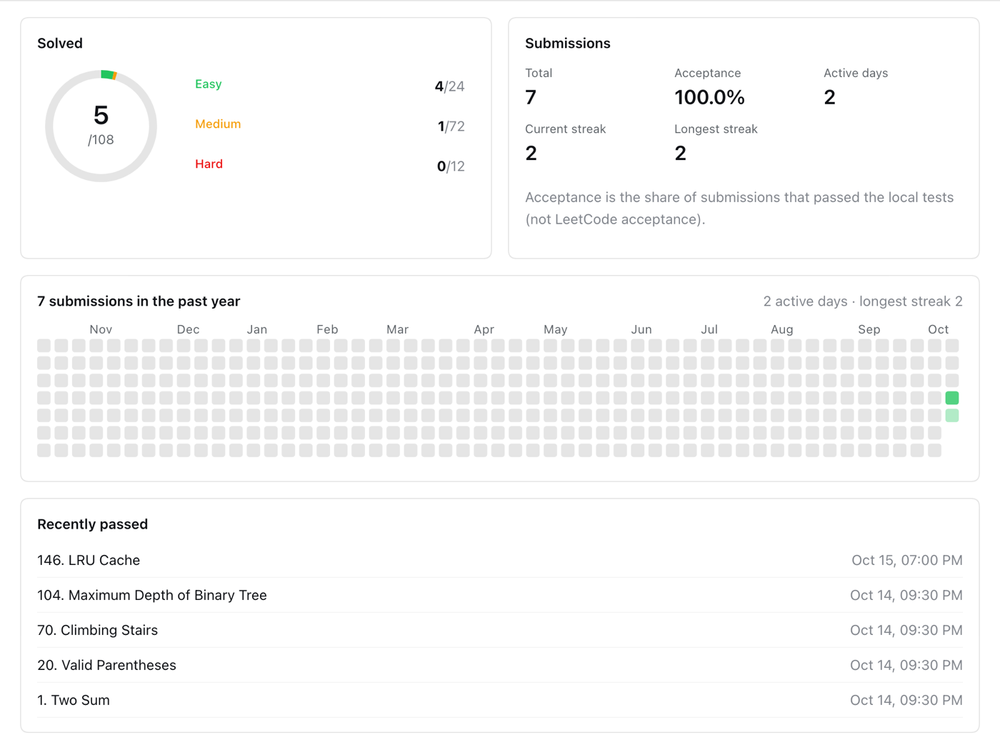
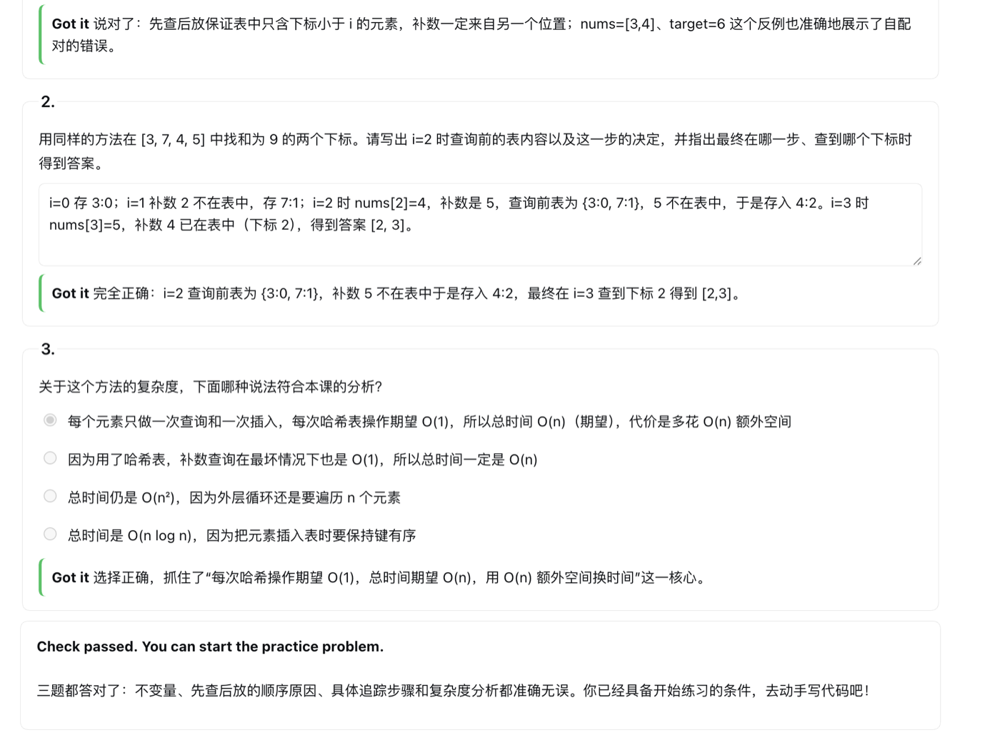
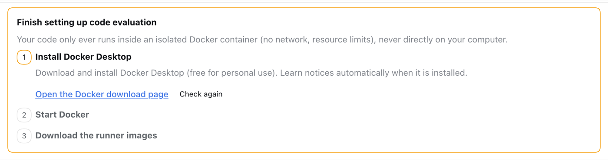
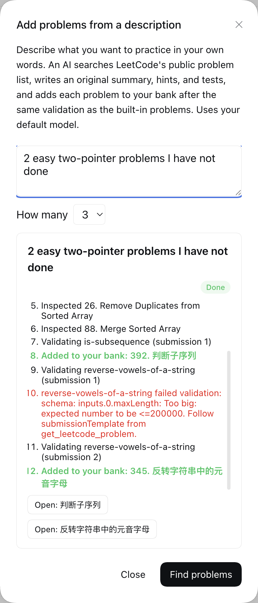

<div align="center">


# DeepSeek Harness LeetCode

**在 [DeepSeek Harness](https://github.com/deepseek-ai/deepseek-harness) 里学算法：课程讲解、完整的力扣热题 100、本地沙箱评测和 AI 辅导。**

[English](README.md) | 中文


</div>

## 亮点

- **完整的力扣热题 100**，另加 8 道经典题。每道题都有原创概述、三级递进提示和讲解，题面保留在 LeetCode，并附官方链接。
- **本机上的真实评测。** 代码在无网络的 Docker 中运行，隐藏的边界、随机和大规模用例能发现错误解和超时解；设计题、原地修改题、链表与树的节点题都支持。
- **先学再练。** 16 个主题，从哈希到动态规划，每个主题都有可以逐步推演的示例。学完后由导师根据本课出几道检查题、评阅你的回答，并判断你是否可以开始实战题。
- **一句话添加题目。** 例如“3 道我没做过的中等 BFS 题”：AI 智能体会在 LeetCode 上找题、编写测试，只有通过校验的题才会加入题库。

## 界面一览

<p align="center"><br><b>热题 100</b>：沿用 LeetCode 的分组，显示每组进度</p>

<table>
  <tr>
    <td width="50%"></td>
    <td width="50%"></td>
  </tr>
  <tr>
    <td align="center"><b>做题</b>：编辑器、运行与提交、隐藏测试</td>
    <td align="center"><b>提交记录</b>：执行用时、内存消耗和每一次提交</td>
  </tr>
</table>

<p align="center"><br><b>做题记录</b>：按难度统计、全年提交日历、连续天数和最近通过</p>

<table>
  <tr>
    <td width="50%"></td>
    <td width="50%"></td>
  </tr>
  <tr>
    <td align="center"><b>学习</b>：可逐步推演的示例</td>
    <td align="center"><b>提示</b>：方向、关键观察、思路大纲、解答</td>
  </tr>
</table>

<p align="center"><br><b>导师检查</b>：根据本课出题，由导师评阅回答（DeepSeek 真实输出）</p>

此外还有 AI 辅导对话、使用新变体题的间隔复习、按知识点统计的进度，以及可选的每日提醒邮件。

## 快速开始

1. **安装 Docker Desktop。** 之后由 Learn 引导完成其余步骤：一键启动 Docker、一键下载运行镜像；也可以自己运行 `docker pull python:3.13-alpine node:24-alpine`。

   

2. **安装插件**，地址为 `github:kapelame/deepseek-harness-leetcode`：
   - **桌面端：** 插件 → 从 GitHub 安装。
   - **Web：**

     ```sh
     dsh plugin --profile web add github:kapelame/deepseek-harness-leetcode
     dsh web
     ```

3. 在侧边栏**打开 Learn**。讲解默认中文，可在“Learn → 设置”中切换为英文。

需要 DSH 0.2.0-rc.2 或更高、低于 0.3 的版本（已在 0.2.0-rc.2 和 0.2.1-alpha.3 上测试）。默认模型（例如登录 DeepSeek）是可选的，用于辅导、导师出题的课程检查、AI 反馈和添加题目；运行、评测、预置提示和课程自带的检查题不需要模型。

<details>
<summary><b>在桌面端用命令行安装</b></summary>

先完全退出桌面端，运行桌面端自带的 CLI，再重新打开桌面端：

```sh
"/Applications/DeepSeek Harness.app/Contents/Resources/runtime/cli/bin/dsh" plugin --profile desktop add github:kapelame/deepseek-harness-leetcode
```

仓库附带预先构建好的 `lib/`，安装时不运行构建脚本。如需可复现的安装，可固定提交：`github:kapelame/deepseek-harness-leetcode#<commit>`。

</details>

## 评测方式

判定只来自测试执行。代码在 Docker 容器中运行：无网络、只读文件系统，并限制内存、CPU 和进程数；期望答案从不进入容器。每套测试由官方示例输入和隐藏的边界、随机、大规模用例组成，由参考解生成，并与独立的暴力解对拍。通过表示**“通过本地测试”**，不等于 LeetCode 判定通过。可选的 AI 评测只给反馈，不能改变判定。

## 添加题目



在“练习 → **添加题目**”中描述需求并选择数量（1–5）。进度实时显示，可随时停止；已添加的题目会保留。

- 智能体遵循随插件附带的技能 [`skills/learn-problem-author/SKILL.md`](skills/learn-problem-author/SKILL.md)，它只在查找器智能体内部可见，不会出现在你平常的 Session 中。
- 题号、标题、难度、标签、签名和示例始终来自 LeetCode 元数据，而不是模型。付费题和需要特殊评测器的题会被跳过。
- 每道题都必须通过与内置题目相同的校验才会加入。
- 我们用 DeepSeek 实测时，每次运行用时 70–300 秒，都添加了要求数量的题目。

<br clear="right">

## 隐私

- 代码只在离线的 Docker 容器中运行。
- 配置默认模型后，“提交”（除非 `agents.judge: false`）、提示、辅导、反思和变体生成会通过 DSH 把题目概述和你的代码发送给该模型，课程检查会发送课程内容和你的回答；“添加题目”只发送你的描述和 LeetCode 元数据，不发送代码。每次运行都会出现在 Session 历史中。
- “添加题目”只向 LeetCode 公开 GraphQL 接口查询题目元数据：不登录、不获取题面，请求有间隔并有每次运行的上限。
- 除此之外不会有数据离开你的电脑；配置 SMTP 后的提醒邮件除外。

<details>
<summary><b>配置</b></summary>

插件会在配置中加入两行：`learn`（服务）和 `learn-ui`（Remote API 与界面）。可在配置的 `cordis.patch.yml` 中覆盖设置。补丁会替换该行的整个 `config`，所以请保留 `dataRoot`：

```yaml
- id: learn
  config:
    dataRoot: !!js dshHomePath('learn')
    defaultLocale: en
    reviewDailyLimit: 3
    agents:
      judge: false              # 只做确定性评测，不请求 AI 反馈
      variantGeneration: true
    finder:
      enabled: true
      maxProblems: 5            # 每次“添加题目”最多添加的题数
      maxSubmissionsPerProblem: 3
      maxLeetcodeRequests: 40   # 每次运行的 LeetCode 请求上限
      requestIntervalMs: 1000
    email:
      transport: capture        # 'smtp' 只有在 liveSendingAuthorized: true 时才发送
```

学习数据保存在 DSH home（默认 `~/.dsh`）下的 `learn/` 中，可在“设置”中导出为 JSON 或重置。

真实邮件需要 `email.transport: smtp`、`email.liveSendingAuthorized: true`、`email.smtp.host`/`port`/`user`，并把 SMTP 密码存为名为 `email.smtp.passwordRef` 的 DSH 凭据（默认 `DSH_LEARN_SMTP_PASSWORD`）。未使用隐式 TLS 时要求 STARTTLS。

</details>

<details>
<summary><b>已知限制</b></summary>

- 运行代码需要 Docker。DSH 自带的进程沙箱只限制写文件（仍可联网、可读取你的文件），因此 Learn 不用它代替 Docker。
- 只有在 DSH 运行且启用插件时才会发送提醒；错过的每日摘要会在当天稍晚补发，不会推迟到之后的日期。
- TypeScript 提交只剥离类型，不做类型检查。
- 辅导只看到对话中最近的十条消息。
- AI 运行进行期间，其 Session 会短暂出现在侧边栏中。
- 在桌面端，提醒邮件中的链接指向每次启动都会变化的本地端口；请使用邮件中的验证码，或设置 `email.publicBaseUrl`。

</details>

<details>
<summary><b>从源码构建</b></summary>

`source/` 中是三个 DSH workspace 包，使用 DSH 工具链构建：

```sh
git clone https://github.com/deepseek-ai/deepseek-harness.git dsh
git -C dsh checkout dsh-v0.2.0-rc.2
node scripts/build.mjs ./dsh    # 复制源码、安装依赖、构建并组装 lib/
```

已安装依赖的代码可用 `--skip-install` 重新构建。测试在 DSH 代码中运行：`npx vitest run packages/experimental/learn/tests`（需要 Docker）。

课程内容位于 `content/`（`content/collections/hot-100.yaml` 列出热题 100 的分组）。每道题包含声明输入域的 YAML 元数据、参考解、独立的暴力解、可选钩子，以及经过校验的冻结测试集。`authoring/` 中是生成热题 100 内容和冻结测试集的脚本。

</details>

## 许可证

MIT
